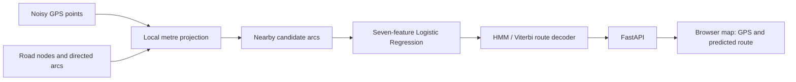

# PathSnap Team and Demo Guide

This is the shared briefing for the four presenters. It explains the problem, the data, the current implementation, the results, the charts, and the two-laptop demo. It describes what the submitted files actually do; it does not treat every item in the role plan as proof that a separate artifact was produced.

## 1. Project in one minute

GPS devices report noisy positions. A point can fall between roads or near several parallel roads, so selecting the nearest road independently at every timestamp can create an implausible zig-zag. PathSnap:

1. projects the trip and road graph into local metre coordinates;
2. finds nearby directed road segments for each GPS point;
3. scores each point/road candidate with a trained binary classifier;
4. uses an HMM-style Viterbi decoder to find a sequence that balances those scores with directed road connectivity; and
5. serves the route to a browser map through FastAPI.



**Short presentation line:** “The classifier scores plausible roads at each GPS point; Viterbi uses road direction and continuity to turn those scores into one coherent route.”

## 2. What the supplied files mean

Each trip folder has four whitespace-separated files, normally without a header:

| File | Meaning | How the code uses it |
| --- | --- | --- |
| `<trip>.track` | Longitude, latitude, timestamp for each GPS observation | The noisy input sequence; the timestamp differences are treated as seconds. |
| `<trip>.nodes` | Longitude, latitude for each road node | Coordinates used to build road segments. |
| `<trip>.arcs` | Start-node index and end-node index for each directed road segment | Arc IDs are the row positions in this file; direction matters. |
| `<trip>.route` | One directed arc ID per reference route step | Used to create heuristic labels for development and to score the evaluator trip on the server after prediction. |

Node and arc indexes are zero-based and belong to their trip. Arc ID 12 in one trip is unrelated to arc ID 12 in another. The `.route` file is reference information: it is not an inference feature.

### Partitions and data handling

The provided split is 80 training trips, 10 `student_test` trips, and 10 `evaluator_test` trips. The implementation keeps trips intact when making group-aware validation folds.

- `train`: fit the model and run grouped model selection/tuning.
- `student_test`: development evaluation after selection; useful for the report, but not an untouched final benchmark.
- `evaluator_test`: reserved for the live evaluator demonstration. Do not use it to tune features, choose a model, or adjust parameters.

The API runs inference first. It reads a reference route on the server only after inference to calculate an aggregate score. It does not send reference arc IDs to the browser.

## 3. Person-by-person responsibilities and handoff

### Person 1 — Data, EDA, and features

**What this role owns:** trip/data checks, coordinate projection, candidate generation, label alignment, feature-table definition, candidate misses, EDA/report section 2.2, and Folium EDA maps if required by the judging rubric.

**Main files:** [`pathsnap_person1.py`](../pathsnap_person1.py), [`eda.py`](../eda.py), and generated files in `eda/`.

**What the current implementation does:**

- Reads each trip’s track, nodes, arcs, and route, and checks required indexes and timestamp order.
- Projects longitude/latitude into a local equirectangular plane measured in metres. This avoids calculating road distance directly in degrees. It is a practical local approximation, not a formal UTM reprojection.
- Indexes road-segment bounding boxes in a 100 m spatial grid.
- For each GPS point, considers up to 8 road candidates within 80 m.
- Aligns the GPS sequence monotonically to the reference route. A route label is kept only when the alignment distance is at most 50 m.
- Creates the seven model features described below, plus metadata and label-only columns.
- The current EDA script reads `train` and `student_test` only. It deliberately does not open `evaluator_test`.

**Important results to report:**

| Partition | Trips | GPS observations | Route-labeled observations | Positive route candidate present | Candidate misses |
| --- | ---: | ---: | ---: | ---: | ---: |
| Train | 80 | 208,417 | 159,244 (76.40%) | 157,218 | 2,026 (1.27% of labeled observations) |
| Student test | 10 | 19,160 | 18,846 (98.36%) | 18,656 | 190 (1.01% of labeled observations) |

EDA found no invalid GPS coordinates, invalid timestamps, or invalid arc endpoints across these 90 development trips. It found zero isolated road nodes in these partitions. Some trips still have multiple **weakly connected components**: that metric ignores arc direction, so it describes disconnected pieces in the undirected sense, not whether every directed route is reachable from every other arc.

**How to explain a candidate miss:** “The correct route arc was not among the generated candidates. A classifier cannot select a road it was never offered.” Candidate coverage is therefore a separate ceiling on model performance.

**Handoff to Person 2:** the shared candidate table convention is one row per `(trip_id, obs_idx, candidate_arc_id)`. The feature names in the model artifact are the agreed classifier input order. Keep `aligned_route_arc_id`, `label_known`, `is_route_label`, and `route_alignment_dist_m` out of model inputs.

### Person 2 — Models and Bayesian search

**What this role owns:** training five model families, grouped evaluation, the chosen model, hyperparameter search, comparison plots, and report sections 3 and 4.

**Main files:** [`train_models.py`](../train_models.py), [`cross_validate_models.py`](../cross_validate_models.py), [`bayesian_tune.py`](../bayesian_tune.py), [`compare_tuned.py`](../compare_tuned.py), [`train_final_model.py`](../train_final_model.py), [`evaluate_student_test.py`](../evaluate_student_test.py), and [`plot_results.py`](../plot_results.py).

**The five models compared:**

| Model family | Why include it |
| --- | --- |
| Logistic Regression | Fast, interpretable baseline; outputs candidate probabilities. |
| Decision Tree | Simple nonlinear baseline that can learn feature thresholds. |
| Random Forest | Bagged trees reduce the variance of one decision tree. |
| Extra Trees | Randomized tree ensemble; useful comparison against Random Forest. |
| Histogram Gradient Boosting | Boosted trees can model nonlinear feature interactions and often give strong probabilities. |

The final artifact is **StandardScaler + Logistic Regression**, with `C=1`, `max_iter=300`, and `lbfgs`. `C` is inverse regularization strength: smaller values constrain the coefficients more; larger values allow a more flexible fit. Scaling is important because distance, time, and angular features have different numeric ranges.

**Why Logistic Regression was selected:** observation-level Top-1 is the primary task metric: among the candidate roads for one observation, did the highest-scoring road match the aligned reference arc? In five-fold `GroupKFold`, the entire trip is assigned to one fold, so observations from the same trip never appear on both sides of a fold.

| Model | Observation Top-1, mean ± std | Candidate macro F1 | Candidate log loss |
| --- | ---: | ---: | ---: |
| Logistic Regression | 75.63% ± 2.87 pp | 0.7883 | 0.2628 |
| Extra Trees | 75.61% ± 2.61 pp | 0.7555 | 0.3627 |
| Hist Gradient Boosting | 73.94% ± 2.68 pp | **0.8113** | **0.2274** |
| Random Forest | 73.89% ± 2.85 pp | 0.7877 | 0.2944 |
| Decision Tree | 70.42% ± 3.40 pp | 0.7518 | 0.6472 |

Logistic Regression and Extra Trees are effectively tied on Top-1. Logistic Regression was retained because it is simpler, has better candidate macro F1 and log loss than Extra Trees in this run, and its recorded inference time was roughly nine times lower. Hist Gradient Boosting wins on candidate macro F1 and log loss, but it is weaker on the primary observation Top-1 metric. These timings depend on the machine and software environment.

**Bayesian search:** a small Gaussian-process search tested 10 values of `C` over `10^-3` to `10^3` using three trip-grouped folds on training trips. It selected `C=1`, with 75.62% ± 3.08 pp mean Top-1. The tuned comparison is effectively identical to untuned `C=1`; do not claim tuning improved the score.

**Teacher’s question about stronger models:** Logistic Regression is a basic model, but the project did not compare it only with basic models. Hist Gradient Boosting is a boosted-tree ensemble and was the strongest of the five on candidate macro F1 and log loss. We also screened two nearby Hist Gradient Boosting settings on the same three trip-grouped folds as Logistic Regression. This quick screen is supplementary; the saved five-fold summary remains the primary comparison.

| Model from the review-only three-fold screen | Observation Top-1 | Candidate macro F1 | Candidate log loss |
| --- | ---: | ---: | ---: |
| Logistic Regression C=1 | 75.62% | 0.7885 | 0.2589 |
| Extra Trees | 75.75% | 0.7594 | 0.3585 |
| Hist Gradient Boosting, current settings | 74.60% | **0.8134** | **0.2254** |
| Hist Gradient Boosting, setting A | 74.62% | 0.8132 | 0.2253 |
| Hist Gradient Boosting, setting B | 74.25% | 0.8116 | 0.2265 |

The small Extra Trees Top-1 lead in this three-fold screen is only 0.13 percentage points and did not appear as a lead in the saved five-fold summary (Logistic Regression 75.63%, Extra Trees 75.61%). A final student-test route check gave 79.63% weighted Top-1 for Hist Gradient Boosting + HMM versus 81.55% for Logistic Regression + HMM. **Decision: keep Logistic Regression for the demo** because it is strongest or effectively tied on the route-ranking metric and had the higher end-to-end student-test route score; do not switch just to use a more complex model. Be clear that Hist Gradient Boosting is better on the candidate-level F1/log-loss measures. The student-test check is a development result, not a fresh benchmark.

**Final student-test check:** the final model was trained on the 80 training trips and evaluated on the 10 student-test trips. It achieved 76.33% all-label Top-1, counting the 190 candidate misses as wrong; candidate accuracy was 89.24%, candidate macro F1 0.7955, and candidate log loss 0.2706.

**Candidate-level confusion matrix on student-test** at probability cutoff 0.5 (rows are actual 0/1; columns predicted 0/1):

|  | Predicted negative | Predicted positive |
| --- | ---: | ---: |
| Actual negative | 98,634 (TN) | 7,507 (FP) |
| Actual positive | 5,924 (FN) | 12,732 (TP) |

This matrix answers “did each candidate row get classified as route or not?” It is **not** the same as observation-level Top-1, which ranks all candidates belonging to one GPS point. Candidate misses have no candidate row to classify and are handled separately in all-observation Top-1.

### Person 3 — HMM and Viterbi route reconstruction

**What this role owns:** candidate states, emissions, transitions, handling gaps/missing candidates, route continuity, comparison against the classifier-only path, map layers, and report sections 5 and 6.

**Main files:** [`hmm_decode.py`](../hmm_decode.py), [`render_trip_map.py`](../render_trip_map.py), and the aggregate HMM result in `features/student_test_hmm_aggregate.csv`.

**Decoder in plain language:**

- A hidden state at time `t` is one candidate directed road arc for GPS point `t`.
- The emission score is the log of the classifier probability for that candidate. A likely candidate receives a better score.
- Staying on the same arc has transition score 0. Moving to an arc whose start node equals the previous arc’s end node gets -1. A disconnected jump gets -5.
- Viterbi accumulates emission plus transition scores over the sequence and uses back-pointers to recover the highest-scoring whole path. It can select a slightly lower-scoring candidate at one point if doing so makes the whole sequence more plausible.
- Decoding restarts across a missing-candidate observation, a non-consecutive observation index, or a GPS time gap longer than 60 seconds. It does not force a route across an outage.

**Student-test aggregate result:** weighted all-label Top-1 increased from 76.33% (classifier only) to 81.55% (classifier + HMM). Mean Top-1 across the 10 trips increased from 79.06% to 84.45%. Mean continuity across decoded adjacent observations increased from 86.79% to 99.47%. The HMM did not improve every individual trip, and these fixed transition penalties were not separately nested-tuned.

**What the maps show:** the browser UI draws the GPS trace as dashed blue with a white outline, the predicted road route in red, and green/purple start/end markers. The current offline Folium renderer shows the GPS trace and HMM-predicted arcs; it does not currently add the full road-network or reference-route layers, so do not claim those are in the saved Folium map. The EDA script creates statistical charts, not a Folium EDA map. If the rubric checks for those Folium maps/layers specifically, those artifacts still need to be added. Keep coordinate-bearing HTML maps local.

### Person 4 — API, UI, deployment, and integration

**What this role owns:** FastAPI endpoints, the trip selector and map UI, two-laptop networking, logging/screenshots, repo setup, README/requirements, final report assembly, and report section 7.

**Main files:** [`api/app.py`](../api/app.py), [`api/static/index.html`](../api/static/index.html), [`README.md`](../README.md), [`requirements.txt`](../requirements.txt), and [`build_report.py`](../build_report.py). The final report is `reports/PathSnap_Hackathon_Report.pdf`.

**Endpoints:**

| Request | Purpose |
| --- | --- |
| `GET /` | Serves the browser map interface. |
| `GET /health` | Confirms the API is running and shows active partition/model. |
| `GET /trips` | Returns available trip IDs for the server’s selected partition. |
| `POST /predict` with `{"trip_id":"..."}` | Runs candidate scoring and Viterbi, returns GPS and predicted-route coordinates plus an aggregate score when reference labels are available on the server. |

## 4. Features and code flow

### Seven classifier features

| Feature | Plain-language meaning |
| --- | --- |
| `dt_s` | Seconds since the previous GPS observation. |
| `gps_speed_mps` | Distance moved between GPS points divided by elapsed time. |
| `candidate_dist_m` | Perpendicular distance from GPS point to this road segment. |
| `road_length_m` | Length of the directed road segment. |
| `gps_move_bearing_rad` | Direction of observed GPS movement. |
| `road_bearing_rad` | Direction of the candidate segment. |
| `bearing_diff_rad` | Smallest wrapped angular difference between movement and road direction. |

`partition`, `trip_id`, `obs_idx`, arc IDs, GPS timestamp, alignment distance, and route labels are metadata or label/debug fields. They are not among the model inputs. Excluding route-derived labels and distances prevents reference information from leaking into inference.

### Key functions to point to in code

- `pathsnap_person1.py`: `project`, `build_segments`, `spatial_index`, `nearby`, `align_route_observations`, and `process_trip` implement the map-matching data preparation.
- `train_models.py`: defines the feature list, negative sampling, candidate scoring, and initial trip-grouped holdout comparison.
- `cross_validate_models.py`: defines all five estimators and the five-fold trip-grouped evaluation.
- `bayesian_tune.py`: proposes `C` values and evaluates their grouped-fold Top-1 objective.
- `train_final_model.py`: refits the chosen pipeline using all training trips and writes `models/logistic_candidate_model.joblib`.
- `hmm_decode.py`: `decode` splits observations into continuous segments, scores transitions, then backtracks through Viterbi pointers.
- `api/app.py`: `infer` reconstructs candidates from raw trip files, calls `predict_proba`, invokes `decode`, then packages the predicted route for the UI.

The API tries the standard 80 m candidate radius first and, only if it finds none, retries within 500 m. That fallback can help avoid an empty display, but very distant fallback candidates are outside the main 80 m training candidate range and should be interpreted cautiously.

## 5. What each result CSV contains

Use files ending in `_aligned` for the finalized model results. Earlier files without that suffix are preserved first-run drafts and should not be mixed into the final comparison. Large candidate tables and row-level predictions are intentionally kept local.

### Public aggregate result files

| File | What each row means / how to use it |
| --- | --- |
| `features/data_quality_summary.csv` | One row per partition; trip/observation totals, route-label coverage, positive candidate coverage, and candidate misses. |
| `features/initial_model_comparison_aligned.csv` | One row per model from the earlier 80/20 trip-grouped holdout experiment. It is a preliminary check; use the five-fold file below for final model choice. |
| `features/group_cv_folds_aligned.csv` | One row per model per validation fold, including candidate accuracy, macro F1, log loss, observation Top-1, training seconds, and inference time. |
| `features/group_cv_summary_aligned.csv` | One row per model, summarizing the five grouped folds with mean and standard deviation. This is the main comparison table. |
| `features/group_cv_protocol_aligned.txt` | States the grouping, fold count, negative sampling, and which partitions were excluded. |
| `features/bayesian_trials_aligned.csv` | One row per tested `C`, with log10(C), mean/std Top-1, training time, and the three fold scores. |
| `features/bayesian_best_aligned.txt` | Search method, objective, best `C`, and best score. |
| `features/bayesian_comparison_folds_aligned.csv` | Per-fold comparison for the untuned and Bayesian-selected settings on matched grouped folds. |
| `features/bayesian_comparison_aligned.csv` | Aggregate comparison of untuned `C=1` and selected `C=1`; the equal result documents that tuning found no gain. |
| `features/student_test_metrics_aligned.csv` | One-row classifier evaluation on the 10 student-test trips, including all-label Top-1, candidate metrics, training/inference time, and misses. |
| `features/student_test_hmm_aggregate.csv` | HMM vs classifier aggregates for weighted Top-1, per-trip macro Top-1, and continuity, with metric definitions. |

### Local files; do not publish them

| File | Why it stays local |
| --- | --- |
| `features/train_candidates_aligned.csv` and `features/student_test_candidates_aligned.csv` | Large row-level tables with trip/observation/arc identifiers and route-derived labels. Regenerate from local data. |
| `features/student_test_hmm_predictions_aligned.csv` | Per-observation predicted and reference arc IDs; this is not an aggregate result. |
| `features/student_test_hmm_summary_aligned.csv` | Per-trip scores keyed by trip ID; keep with local evaluation artifacts. |
| `eda/eda_trip_summary.csv` | Per-trip data-quality statistics. The aggregate partition summary can be shared instead. |
| Folium HTML maps | Contain GPS route coordinates. Keep on the machine used for local inspection. |

`eda/eda_partition_summary.csv` is the aggregate output from the current EDA run. `features/README.md` describes the aligned-file convention and local-only large files.

## 6. EDA and model charts: what they show

The current local EDA output is in `eda/`. It was generated from the 80 train and 10 student-test trips only. To regenerate it from the project root, run `python eda.py --data-root .\data --output-dir .\eda`. To regenerate the model/HMM charts, run `python plot_results.py`.

| Chart | What is plotted | How to explain the result |
| --- | --- | --- |
| `01_trip_structure.png` | Per-trip GPS, node, directed-arc, and route-arc counts; log y-axis; outliers hidden for readability. | Shows trip/network sizes vary substantially. The log scale lets small and large trips appear together. |
| `02_observations_per_trip.png` | Histogram of GPS observations per trip by partition. | Shows how much trip length/sequence size varies. Large trips matter for runtime and weighted metrics. |
| `03_motion_distributions.png` | GPS-derived speed distribution (0–60 m/s displayed) and trip duration distribution. | Helps spot implausible speeds and very short/long trips. The displayed speed range is clipped for readability, not a claim that no higher values exist. |
| `04_sampling_gaps.png` | GPS observation count against number of timestamp gaps over one second, one point per trip. | Shows which trips have more sampling interruptions; it does not show gap durations themselves. |
| `05_network_quality.png` | Weakly connected component count against isolated-node count, one point per trip; symlog axes. | Isolated nodes are zero in these development trips, while component counts vary. Weak connectivity ignores one-way direction. |
| `06_candidate_coverage.png` | Route-label coverage and fraction of labeled observations without a positive road candidate by partition. | Candidate misses happen before classification, so they are a preprocessing/coverage issue as well as a limit on the final score. |
| `07_representative_trajectories.png` | Six training GPS traces centered at their own start point, axes in metres. | Illustrates trip shapes without raw longitude/latitude axes. These are still trajectory-derived visuals; keep the file local. |
| `08_model_comparison.png` | Five-fold grouped mean Top-1, candidate macro F1, and log loss; error bars show fold standard deviation. Blue marks the selected Logistic Regression; gray bars are alternatives. | Logistic Regression is the selected model on Top-1; Hist Gradient Boosting is strongest on the two candidate-level metrics. |
| `09_hmm_effect.png` | Classifier-only vs HMM aggregate Top-1 and continuity. | The decoder improves overall route agreement and makes adjacent decoded arcs much more continuous. One aggregate improvement does not mean every trip improved. |

**Metric vocabulary:**

- **Candidate accuracy/F1/log loss** evaluate each candidate row as positive route arc or negative candidate. Macro F1 weights the positive and negative class F1 scores equally. Lower log loss is better and rewards calibrated probabilities.
- **Observation Top-1** groups candidates by GPS observation, chooses the candidate with highest probability, and checks if it is the aligned route arc. This matches the classifier’s ranking job.
- **Weighted score** pools all labeled GPS observations, so long trips count more. **Macro-by-trip score** calculates each trip separately and averages the ten trip scores, so each trip counts equally.
- **Continuity** is the fraction of decoded adjacent observation pairs that stay on the same directed arc or move to a directed successor. It is not route accuracy by itself; a wrong route can still be internally continuous.
- **Candidate miss rate** counts labeled GPS observations whose reference road is absent from the candidates. Such an observation cannot be fixed by changing the classifier.

## 7. Live two-laptop demo

Your earlier demo run showed `status: ok`, a populated trip selector, and the blue GPS trace with the red predicted path. Use this checklist on demo day.

### Laptop 1 — model and API

From the PathSnap project folder on Laptop 1:

```powershell
$env:PATHSNAP_PARTITION = "evaluator_test"
uvicorn api.app:app --host 0.0.0.0 --port 8000
```

Keep the evaluator data on Laptop 1 under `data\evaluator_test\`. `0.0.0.0` makes the server listen on the laptop’s network interfaces; it is not the address Laptop 2 should type. Confirm Laptop 1’s current IPv4 address on the same Wi-Fi/network. The previous address used was `10.0.15.101`; it may change.

### Laptop 2 — evaluator UI

1. Open `http://<Laptop-1-IPv4>:8000/` in a browser, replacing the placeholder with Laptop 1’s current network address.
2. Wait until the status says how many trips loaded.
3. Select one of the listed evaluator trip IDs and click **Reconstruct route**.
4. Explain the display: dashed blue with white outline = observed GPS; red = predicted road path; green = start; purple = finish. If the evaluator provides an accuracy score, it is an aggregate server-side comparison.

### If the dropdown or map fails

- On Laptop 1, open `http://127.0.0.1:8000/health`; confirm `status` is `ok` and `partition` is `evaluator_test`.
- On Laptop 2, use Laptop 1’s current IPv4, not `0.0.0.0`; leave the API-address field empty to use the page’s own server address.
- Confirm both laptops are on the same network and Laptop 1 allows Python/Uvicorn through the private-network firewall.
- If the selector works but map tiles are blank, the OpenStreetMap tile service may be unreachable. The route lines still come from the API; the background map needs internet access.
- If no road candidates are found, the map may show GPS but little/no red route. Try another listed trip and report it as a candidate-coverage limitation rather than claiming the route exists.

## 8. Suggested speaking order and judge questions

### 4-person presentation flow

1. **Person 1 (about 45 seconds):** explain the files and trip split, why coordinates are projected into metres, how nearby candidates are generated, the seven features, and the 1.01% student-test candidate miss rate.
2. **Person 2 (about 60 seconds):** show the five-model comparison, explain trip-grouped CV, justify Logistic Regression on observation Top-1, and state honestly that Bayesian tuning selected the same `C=1`.
3. **Person 3 (about 45 seconds):** explain candidate states, probability emissions, same/connected/disconnected transition scores, the 60-second gap break, and the HMM improvement with its limitations.
4. **Person 4 (about 60 seconds):** show `/health`, the trip selector, select a trip, reconstruct, identify the map colors, and explain the two-laptop setup and server-side reference labels.

The current repo does not include captured demo screenshots. Person 4 should save screenshots of `/health`, the populated trip selector, and the finished map during the live run if the submission form asks for them.

### Likely questions and prepared answers

**Why not choose the geometrically nearest road?** GPS noise, parallel roads, and intersections can make the nearest road wrong at one instant. The model uses distance and movement/road direction, and the HMM uses sequence continuity.

**Why Logistic Regression if boosting has better F1 and log loss?** The primary task metric is observation-level Top-1, where Logistic Regression was best and Extra Trees was effectively tied. Boosting had the strongest candidate-level metrics but lower Top-1. We selected for the route-candidate ranking objective and runtime simplicity.

**What does `C=1` mean? Did Bayesian tuning help?** `C` controls inverse regularization strength. The search selected `C=1`, which matched the untuned default; no measurable gain was shown.

**What does a candidate miss mean?** The correct reference arc was not in the generated candidate list. No classifier can rank a missing candidate, so the miss is counted wrong in all-observation Top-1.

**Is 81.55% the same as the 84.45% HMM score?** No. 81.55% pools all labeled observations, giving long trips more weight. 84.45% averages per-trip accuracies, giving each of 10 trips equal weight.

**Did we use the evaluator labels to train or tune?** No. Training and tuning use the 80 train trips. The 10 student-test trips are a development evaluation. The evaluator partition is selected only for the live API; the route reference is read after inference on Laptop 1 for aggregate scoring.

**Are the reported labels perfect ground truth?** No. The `.route` labels are aligned to GPS with a monotone spatial heuristic and 50 m threshold. All scores measure agreement with those heuristic labels and are provisional; long GPS gaps, intersections, and repeated roads can affect alignment.

**Why can candidate macro F1 differ from observation Top-1?** Candidate F1 decides positive/negative separately for every candidate row at a threshold. Observation Top-1 ranks candidates against one another within each GPS point. They answer different questions.

## 9. Limits to state clearly

- The route labels are heuristic, not independently verified ground truth.
- Candidate generation limits what the classifier can recover; student-test misses are 190 of 18,846 labeled observations.
- The local equirectangular projection is metre-based and suitable as a local approximation, but is not a formal projected CRS implementation.
- HMM transition penalties are a simple fixed baseline, not separately nested-tuned; one trip can get worse even when the aggregate improves.
- Student-test results are a development check; do not market them as an untouched final benchmark.
- Inference timing depends on the machine and is not a guaranteed latency.

## 10. File quick index

- **Report:** `reports/PathSnap_Hackathon_Report.pdf`
- **Final model:** `models/logistic_candidate_model.joblib`
- **Role 1:** `pathsnap_person1.py`, `eda.py`, `eda/`
- **Role 2:** `train_models.py`, `cross_validate_models.py`, `bayesian_tune.py`, `compare_tuned.py`, `train_final_model.py`, `evaluate_student_test.py`, `plot_results.py`, `FINAL_MODEL_DECISION.md`
- **Role 3:** `hmm_decode.py`, `render_trip_map.py`
- **Role 4:** `api/app.py`, `api/static/index.html`, `README.md`, `requirements.txt`, `build_report.py`
- **Shared results:** `features/*_aligned*`; check the public/local tables in section 5 before sharing any file.

